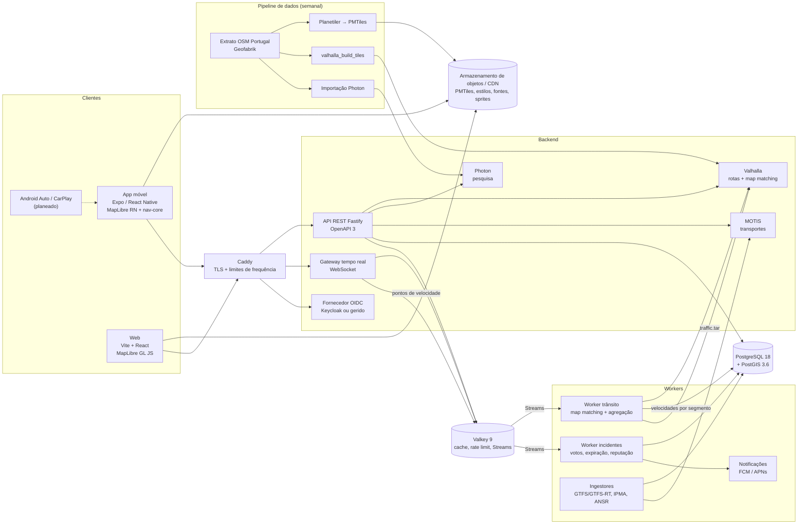

# Trajecto — Fase 0: planeamento, stack e validação de requisitos

| Campo | Valor |
|---|---|
| Estado | **Respostas recebidas**: decisões em `docs/adr/` (estado "Proposto") aguardam confirmação final |
| Data | 2026-10-14 |
| Âmbito | Portugal continental e ilhas, pt-PT, i18n preparada |
| Versões | Verificadas a 2026-10-14 no registo npm, nas tags git dos projetos e nas notas de versão (ver secção 4.10) |

---

## 0. Respostas recebidas e impacto no plano

| # | Resposta | Impacto |
|---|---|---|
| 1 | Uso pessoal; reportes de polícia incluídos | Os reportes de polícia ficam atrás de um interruptor de funcionalidade (ADR 0008). Antes de qualquer distribuição a terceiros é preciso revisão legal. Enquanto o uso for estritamente pessoal, o RGPD não se aplica (art. 2.º, n.º 2, alínea c): é a exceção de atividade pessoal ou doméstica. Mantemos na mesma a privacidade desde a conceção, para não ter de refazer nada se o uso se alargar. |
| 2 | Prioridade à web | O cliente principal passa a ser uma **PWA** (aplicação web instalável) com Vite, React e MapLibre GL JS (ADR 0001). A app Expo / React Native fica adiada para depois da Fase 7. **Android Auto e CarPlay saem do âmbito** enquanto não houver app nativa, porque exigem código nativo. |
| 3 | Sem orçamento | **Custo atual: 0 €.** Tudo corre no teu computador, com Docker quando for preciso (ADR 0005). No arranque usamos serviços públicos gratuitos dentro dos limites deles: tiles do OpenFreeMap e pesquisa no servidor público do Photon. Não há taxas de lojas de apps. |
| 4 | Uso anónimo, conta opcional | Na Fase 1, favoritos e histórico ficam só no browser (IndexedDB). O fornecedor de identidade só é escolhido na Fase 5, quando votos e reputação precisarem dele (ADR 0006). |
| 5 | Nível básico | Cada fase traz instruções passo a passo por sistema operativo, poucos serviços novos de cada vez e explicação de cada comando. A Fase 1 não precisa de servidor próprio nem de Docker. |

Limitações de uma app web para navegação (a confirmar na Fase 3 no teu telemóvel):

- **Geolocalização:** o browser só a fornece em HTTPS ou em `localhost`. Para usar no telemóvel será preciso um endereço HTTPS.
- **Ecrã ligado:** com o ecrã desligado ou o browser em segundo plano, a localização deixa de chegar. Durante a navegação o ecrã tem de estar ligado, o que a Screen Wake Lock API permite. Isto gasta mais bateria, por isso convém um carregador no carro.
- **Voz:** usa a Web Speech API (`speechSynthesis`). A existência e a qualidade de uma voz pt-PT dependem do sistema operativo.
- **Notificações push:** no iPhone só funcionam com a app adicionada ao ecrã principal.
- **Offline:** usa Service Worker e armazenamento do browser, com quotas que variam por browser.

Boa notícia para a web: o núcleo do Ferrostar está publicado no npm para browser (`@stadiamaps/ferrostar` 0.58.0, BSD-3-Clause, com componentes web). Será candidato na Fase 3.

Sugestão de ordem: com um só utilizador, o trânsito calculado a partir dos teus próprios dados (Fase 4) e os reportes comunitários (Fase 5) trazem pouco valor real. Os transportes públicos (Fase 6) usam dados reais desde o primeiro dia. Podes antecipar a Fase 6, se quiseres. Por omissão mantenho a ordem original.

---

## 1. Resumo

Proponho uma stack **TypeScript de ponta a ponta** (backend, web e telemóvel) à volta de serviços open source maduros para os dados geográficos:

- **Valhalla** como motor de rotas: um só grafo para todos os modos, preferências no próprio pedido, trânsito ao vivo e histórico, instruções em pt-PT.
- **MapLibre** no cliente, com tiles vetoriais gerados a partir do **OpenStreetMap** por **Planetiler** e servidos como **PMTiles**.
- **Photon** para pesquisa com autocompletar e geocodificação inversa.
- **PostgreSQL + PostGIS** para os dados, **Valkey** para cache, limites de frequência e filas.
- **Expo / React Native** no telemóvel e **Vite + React** na web.
- **MOTIS** para os transportes públicos (GTFS, NeTEx e GTFS-RT).

Três avisos honestos, antes de mais nada:

1. **"Abrangência do Google Maps" não é alcançável por uma pessoa.** O plano entrega um produto útil e coerente em Portugal, mas a qualidade depende dos dados abertos disponíveis, sobretudo OSM e GTFS.
2. **O trânsito em tempo real a partir de dados dos utilizadores precisa de massa crítica.** Com 100 ou mesmo 10 000 utilizadores, a cobertura será quase nula fora de horas de ponta e de eixos principais. Não encontrei nenhuma fonte aberta e confirmada de trânsito em tempo real para Portugal (ver secção 5).
3. **O modo offline com rotas no dispositivo é o requisito de maior risco técnico.** Mapas offline são viáveis. Rotas offline exigem levar um motor de rotas para dentro da app, e isso fica para investigação na Fase 7.

---

## 2. Perguntas de clarificação

Para cada pergunta indico uma **resposta por omissão**. Se concordares, basta responder "ok à 1, 3, 5", por exemplo.

| # | Pergunta | Porque importa | Resposta por omissão |
|---|---|---|---|
| 1 | **Público e distribuição.** É uso pessoal ou um beta fechado com amigos, ou queres publicar nas lojas para o público? Haverá uso comercial (anúncios, subscrições)? Queres reportes do tipo "polícia"? | Muda o peso do RGPD, da moderação e dos termos legais. O plano gratuito do Open-Meteo só permite uso não comercial. Os reportes de presença policial têm risco legal por confirmar. | Beta fechado, não comercial, até à Fase 7. "Polícia" fica desativado até haver parecer jurídico. |
| 2 | **Plataformas e equipamento.** Qual é a prioridade entre Android, iOS e web? Tens Mac, iPhone e conta Apple Developer? | Testar no simulador de iOS exige macOS. Publicar no iOS exige o Apple Developer Program (99 USD/ano). O CarPlay de navegação exige um *entitlement* aprovado pela Apple. | Android e web primeiro, iOS a partir da Fase 3. |
| 3 | **Orçamento e alojamento.** Qual é o teu teto mensal? Aceitas um VPS na UE ou preferes um servidor em casa? Já tens domínio? | O Valhalla, o Photon e o PostGIS para Portugal precisam de cerca de 8 a 16 GB de RAM num único servidor (estimativa a medir na Fase 2). | Até cerca de 50 €/mês num VPS na UE (ver secção 8). |
| 4 | **Contas e autenticação.** O uso deve ser anónimo com conta opcional? Fornecedor de identidade gerido ou auto-alojado? Quais logins: email, Google, Apple? | Define o IdP. Na App Store, quem oferece login de terceiros tem também de oferecer uma opção equivalente focada na privacidade, como "Iniciar sessão com a Apple". | Anónimo por omissão. Conta só para reportar, votar e sincronizar favoritos. Keycloak auto-alojado, a menos que prefiras um serviço gerido. |
| 5 | **Experiência e ritmo.** Estás à vontade com TypeScript, React e Docker? Quantas horas por semana tens? | Calibra o tamanho de cada fase e a profundidade das explicações. | TypeScript e Docker básicos, cerca de 8 a 10 h por semana. |

---

## 3. Validação de requisitos

| Requisito | Viabilidade | Nota ou ajuste proposto |
|---|---|---|
| Mapa vetorial: zoom, rotação, inclinação, modo escuro | ✅ Alta | MapLibre suporta tudo. Os estilos claro e escuro serão próprios, para evitar problemas de licença de estilos de terceiros. |
| Pesquisa, autocompletar, geocodificação direta e inversa | ✅ Alta | Photon auto-alojado. O Nominatim público não serve para isto: máximo de 1 pedido por segundo, User-Agent identificado e, segundo fontes não oficiais, autocompletar proibido. |
| Favoritos e histórico com opção de apagar | ✅ Alta | Guardados localmente (SQLite) por omissão. Sincronização opcional com conta. |
| Carro, mota, a pé, bicicleta | ✅ Alta | O Valhalla tem os perfis `auto`, `motorcycle`, `bicycle` e `pedestrian` no mesmo grafo. |
| Mobilidade reduzida | ⚠️ Média | O Valhalla suporta `pedestrian` com `type: wheelchair`. A qualidade depende das etiquetas OSM (passeios, lancis, escadas), que são escassas em muitas zonas. |
| Evitar portagens, autoestradas e ferries; rota rápida ou curta | ✅ Alta | O Valhalla aceita `exclude_tolls`, `exclude_highways`, `exclude_ferries`, `use_tolls`, `use_highways`, `use_ferry` e `shortest` em cada pedido. |
| Custo estimado: combustível | ⚠️ Média | Calculado com consumo × distância × preço. Preço configurável. Uma fonte oficial de preços de combustível (DGEG) está por verificar. |
| Custo estimado: portagens | ⚠️ Baixa | O OSM indica se uma via tem portagem, mas não o preço. Não encontrei tabela aberta e legível por máquina. Várias ex-SCUT deixaram de ter portagens em 2025 (lista atual por confirmar). Proposta: na Fase 2 mostrar apenas "tem portagens" e avaliar uma tabela mantida à mão mais tarde. |
| Tempo de chegada com trânsito atual e histórico | ⚠️ Média | O Valhalla suporta velocidades previstas (semana em intervalos de 5 minutos) e trânsito ao vivo. Faltam os dados: no início usamos velocidades por tipo de via, e o histórico próprio constrói-se com o tempo. |
| Reencaminhamento automático | ✅ Alta | Deteção de saída de rota no dispositivo e novo pedido ao servidor, com meta abaixo de 2 s. |
| Voz pt-PT, faixas, limites de velocidade | ⚠️ Média | O Valhalla tem locale `pt-PT` (verificado). A voz usa o TTS do sistema, com qualidade variável por aparelho. Faixas e limites dependem das etiquetas OSM `turn:lanes` e `maxspeed`, que têm cobertura parcial. |
| Partir ou chegar a uma hora; várias paragens | ✅ Alta | O Valhalla suporta `date_time` e múltiplos `locations`. |
| Trânsito por dados de utilizadores | ⚠️ Baixa no início | Requer massa crítica (ver secção 1). |
| Reportes comunitários com votos e expiração | ✅ Alta | Lógica própria em PostGIS e Valkey. Encerramentos e incidentes podem ser injetados no Valhalla. |
| Moderação e anti-spam | ⚠️ Média | Reputação, limites de frequência e verificação de plausibilidade. GPS falso é sempre possível: a mitigação é estatística, não absoluta. |
| Meteorologia na rota | ✅ Alta | Avisos do IPMA por distrito e previsão do Open-Meteo. Ambos têm termos a respeitar (secção 5). |
| Transportes públicos em tempo real | ⚠️ Média | Depende de cada operador. Carris Metropolitana é a mais aberta. Outros feeds estão desatualizados ou por confirmar (secção 5). |
| Combinação de modos | ⚠️ Média | O MOTIS suporta acesso a pé, de bicicleta ou de carro ao transporte público. Rotas multimodais "livres" (por exemplo bicicleta + comboio + bicicleta) ficam por validar na Fase 6. |
| Android Auto e CarPlay | ⚠️ Baixa a média | Planeado, não prometido. Exige UI própria em templates, *entitlement* da Apple e bibliotecas ainda abaixo da 1.0 em React Native. |
| Offline parcial | ⚠️ Mapas sim, rotas difícil | Regiões de mapa transferíveis: viável. Rotas no dispositivo: investigação na Fase 7. |
| Rota em menos de 2 s, trânsito em menos de 10 s | ✅ Plausível | Portugal é um grafo pequeno para o Valhalla. Será medido com k6 na Fase 2 e na Fase 4. |

---

## 4. Proposta de stack, com prós e contras

### 4.1 Visão geral

| Camada | Escolha | Versão | Licença |
|---|---|---|---|
| Dados de mapa | OpenStreetMap, extrato Portugal da Geofabrik | diário | ODbL 1.0 |
| Geração de tiles | Planetiler, perfil OpenMapTiles | 0.10.2 (Java 21+) | Apache-2.0 (código); esquema OpenMapTiles CC-BY-4.0 |
| Formato e serviço de tiles | PMTiles em armazenamento de objetos ou CDN (`go-pmtiles` 1.31.2; JS `pmtiles` 4.5.0) | ver coluna anterior | BSD-3-Clause |
| Tiles no arranque (desenvolvimento) | OpenFreeMap público | — | sem limites nem SLA; atribuição obrigatória |
| Mapa web | `maplibre-gl` | 6.14.0 | BSD-3-Clause |
| Mapa no telemóvel | `@maplibre/maplibre-react-native` | 11.5.0 | MIT |
| Motor de rotas | Valhalla | 3.9.1 | MIT |
| Geocodificação | Photon | 1.3.0 (Java 21+) | Apache-2.0 |
| Transportes públicos | MOTIS | 2.11.3 | MIT |
| Navegação no dispositivo | Ferrostar ou motor próprio em TS (decisão na Fase 3, ver 4.9) | 0.58.0 | BSD-3-Clause |
| Runtime do backend | Node.js LTS "Krypton" | 24.21.0 | MIT |
| Linguagem | TypeScript | **6.0.3** (não a 7.x, ver 4.10) | Apache-2.0 |
| API | Fastify, `@fastify/swagger` (OpenAPI 3), `@fastify/websocket` | 5.12.7 / 9.9.2 / 11.3.4 | MIT |
| Validação de esquemas | zod | 4.6.7 | MIT |
| Base de dados | PostgreSQL + PostGIS | 18.6 + 3.6.4 | PostgreSQL / GPL-2.0+ (extensão usada como serviço) |
| Cache, limites de frequência, filas | Valkey (Streams) | 9.1.2 | BSD-3-Clause |
| App móvel | Expo SDK 57 (`expo` 57.0.28) → React Native 0.86.3, React 19.2.3 | ver coluna anterior | MIT |
| Web | Vite + `@vitejs/plugin-react`, React + React DOM | 8.3.4 / 6.1.2 / 19.3.0 | MIT |
| i18n | i18next | 26.4.4 | MIT |
| Monorepo | pnpm workspaces | 12.11.2 | MIT |
| Lint | ESLint + typescript-eslint | 10.12.0 / 8.71.2 | MIT |
| Testes | Vitest, Playwright, k6 | 5.0.4 / 1.64.0 / 2.3.0 | MIT / Apache-2.0 / AGPL-3.0 (usado só como ferramenta) |
| Identidade | OIDC: Keycloak auto-alojado ou serviço gerido (pergunta 4) | 26.8.1 | Apache-2.0 |
| Infraestrutura | Docker Compose em VPS na UE, Caddy (TLS automático), GitHub Actions | a fixar na Fase 1 | — |
| Observabilidade | OpenTelemetry, Prometheus, Grafana, Loki; erros em Sentry ou GlitchTip | a fixar na Fase 1 | vários (AGPL nos componentes Grafana/Loki, uso interno) |

Bibliotecas secundárias (cliente de Valkey, ORM ou migrações, Sentry, Maestro para testes E2E no telemóvel) serão fixadas e verificadas quando entrarem, na fase respetiva.

### 4.2 Motor de rotas: OSRM vs Valhalla vs GraphHopper

| Critério | OSRM v26.10.0 | **Valhalla 3.9.1** | GraphHopper 11.1 |
|---|---|---|---|
| Licença | BSD-2-Clause | MIT | Apache-2.0 |
| Linguagem e memória | C++, memória alta por perfil | C++, tiles hierárquicos com *memory map*, memória baixa | Java (JVM), memória moderada a alta |
| Algoritmo | Contraction Hierarchies (CH) ou Multi-Level Dijkstra (MLD) | A* bidirecional (unidirecional dependente do tempo quando há hora de partida ou chegada) sobre grafo hierárquico, com custos dinâmicos | CH, Landmarks (A*/ALT) ou Dijkstra flexível |
| Modos com um só grafo | Não: um perfil Lua e uma instância por modo | Sim: `auto`, `motorcycle`, `motor_scooter`, `bicycle`, `pedestrian` (incluindo `wheelchair`), `truck`, `bus`, `taxi`, `multimodal` | Sim, com *custom models* (mais lentos sem CH) |
| Preferências por pedido | `exclude` limitado às classes definidas no perfil | Ricas: portagens, autoestradas, ferries, `shortest`, `use_hills`, polígonos a evitar… | Ricas, com *custom models* |
| Trânsito ao vivo | Re-customização MLD com ficheiros de velocidade | `traffic.tar` com *memory map* (atualização em quente), encerramentos, incidentes | Na versão open source, segundo o meu conhecimento, não há trânsito dependente do tempo (**não verificado**) |
| Velocidades históricas por hora | Não | Sim: perfil semanal em intervalos de 5 minutos (`valhalla_add_predicted_traffic`) | Não verificado |
| Instruções pt-PT | Biblioteca separada `osrm-text-instructions` (pt-PT por verificar) | Locale `pt-PT` incluído (**verificado**) | `pt_PT.txt` incluído (**verificado**) |
| *Map matching* para dados de utilizadores | `/match` | `trace_route` e `trace_attributes` | Módulo de *map matching* |
| Saída para SDKs de navegação | Formato OSRM nativo | `format=osrm` com `voice_instructions` e `banner_instructions` | Formato próprio |
| Transportes públicos | Não | Multimodal com GTFS, mas **sem trânsito** neste modo | Módulo GTFS |
| Velocidade bruta | A mais rápida | Boa (a medir para Portugal) | Muito boa com CH |

**Recomendação: Valhalla.** Os requisitos que mais pesam são as preferências por pedido, os vários modos sem multiplicar servidores, as rotas dependentes da hora, o trânsito ao vivo e o *map matching* para os dados de velocidade. Só o Valhalla os cobre todos na versão open source. O OSRM ganha em velocidade bruta, mas obrigaria a uma instância por modo e não tem rotas dependentes da hora. O GraphHopper é muito bom, mas a parte de trânsito não está confirmada no open source e a JVM consome mais memória.

- **Contras do Valhalla:** é mais lento que o OSRM com CH em rotas muito longas (irrelevante à escala de Portugal) e a documentação está dispersa.
- **Mitigação:** testes de carga na Fase 2 com meta de p95 abaixo de 2 s.

### 4.3 Cliente: Expo / React Native vs Flutter vs nativo

| Critério | **Expo SDK 57 / React Native 0.86.3** | Flutter | Nativo (Kotlin + Swift) |
|---|---|---|---|
| Partilha de código | TypeScript partilhado com backend e web (tipos, esquemas zod, i18n, regras de domínio) | Dart, sem partilha com o backend | Nenhuma: duas bases de código |
| MapLibre | `@maplibre/maplibre-react-native` 11.5.0. Requisitos: RN ≥0.80, React ≥19.1, Expo ≥54 → **compatível** | Pacotes comunitários (versões não verificadas) | SDK oficial MapLibre Native |
| Navegação passo a passo | Ferrostar tem pacotes RN documentados mas **não publicados no npm** (exigem compilação com Rust), ou motor próprio em TS | Sem Ferrostar | Ferrostar nativo, mais maduro |
| Android Auto / CarPlay | `@iternio/react-native-auto-play` 0.8.1 (MIT, abaixo da 1.0) | `flutter_carplay` (não verificado) | APIs oficiais, e o Ferrostar já tem módulo Android Auto (CarPlay ainda em desenvolvimento) |
| Esforço para uma pessoa | Uma base, com módulos nativos pontuais (Expo Modules) | Uma base | Duas bases |

**Recomendação: Expo / React Native**, com *development builds* (não o Expo Go) e módulos nativos só onde for preciso (por exemplo, localização em segundo plano e integração com o carro).

- **Prós:** uma linguagem em todo o projeto e testes de lógica de navegação partilhados entre web e telemóvel.
- **Contras:** a integração com o carro e o Ferrostar em RN ainda estão imaturos.
- **Plano B:** se a Fase 3 mostrar limites sérios, a navegação e o carro podem passar para módulos nativos sem reescrever o resto da app.

### 4.4 Canal de tempo real e fila de eventos

| Opção | Prós | Contras |
|---|---|---|
| **WebSocket** (navegação ativa) | Bidirecional: envia pontos de velocidade em lote e recebe incidentes da rota no mesmo canal | Exige reconexão, *heartbeat* e afinidade ou difusão entre instâncias |
| SSE | Simples, sobre HTTP, bom para a web | Só do servidor para o cliente |
| Push FCM / APNs | Funciona com a app em segundo plano | Latência e entrega não garantidas |

**Proposta:** WebSocket durante a navegação ativa, push para alertas em segundo plano e REST para o resto.

**Fila de eventos:**

- **Começar com Valkey Streams:** grupos de consumidores e entrega pelo menos uma vez, sem acrescentar mais um serviço.
- **Migrar para NATS JetStream (2.15.1, Apache-2.0) se for preciso:** a fila fica atrás de uma interface, para que a troca seja barata.
- **Kafka ou Redpanda:** excessivo para esta escala.
- **Porquê Valkey e não Redis:** desde a versão 7.4 o Redis deixou de ter uma licença puramente BSD. O Valkey é o fork BSD-3 da Linux Foundation e evita essa ambiguidade.

### 4.5 Geocodificação

| Opção | Prós | Contras |
|---|---|---|
| **Photon 1.3.0** | Feito para autocompletar e geocodificação inversa; há *dumps* por país; leve para Portugal | Java 21+; menos rigoroso em moradas com número de porta |
| Nominatim 5.3.2 (GPL-3.0) | Referência do OSM e bom em moradas estruturadas | Não está desenhado para autocompletar; importação pesada |
| Nominatim público | Zero infraestrutura | Máximo de 1 pedido por segundo e sem uso intensivo; inadequado para uma app |

**Recomendação:** Photon auto-alojado, com dados de Portugal.

### 4.6 Tiles do mapa

| Opção | Prós | Contras |
|---|---|---|
| **Planetiler → PMTiles em armazenamento de objetos ou CDN** | Ficheiro estático, sem servidor de tiles, barato e escalável; o mesmo ficheiro serve para transferir regiões offline | Pipeline de geração a manter (cerca de 1 vez por semana) |
| OpenFreeMap | Grátis, sem chave, sem limites, uso comercial permitido | Sem SLA; dependência externa |
| Martin 0.18.1 | Tiles dinâmicos a partir de PostGIS (útil para a camada de incidentes) | Mais um serviço |

**Proposta:** OpenFreeMap na Fase 1 para avançar depressa, e PMTiles próprios logo depois. Ambos usam o esquema OpenMapTiles, por isso os estilos são os mesmos.

### 4.7 Transportes públicos

| Opção | Prós | Contras |
|---|---|---|
| **MOTIS 2.11.3** (MIT) | GTFS, **NeTEx**, GTFS-RT e SIRI; pouca memória; também faz rotas de rua | Comunidade menor que a do OTP |
| OpenTripPlanner 2.10.0 (LGPL-3.0) | Muito usado; GTFS-RT | Java e mais memória |
| Valhalla multimodal | Já está na stack | Sem trânsito neste modo e sem tempo real (confirmado na documentação quanto ao trânsito) |

**Recomendação:** MOTIS. O suporte a NeTEx conta, porque o ponto de acesso nacional português (NAP) trabalha com NeTEx e SIRI. A decisão será revista na Fase 6.

### 4.8 Autenticação

- **Anónimo por omissão:** cada dispositivo recebe um identificador aleatório que não está ligado a dados pessoais.
- **Conta opcional por OIDC** (Authorization Code com PKCE), para reportar, votar e sincronizar favoritos.
- **Fornecedor de identidade:**
  - **Keycloak 26.8.1** auto-alojado. Prós: controlo total e dados na tua infraestrutura. Contra: precisa de cerca de 1 GB de RAM e de atualizações regulares.
  - **Serviço gerido.** Pró: menos manutenção. Contras: dependência externa e termos a verificar. Se escolheres um serviço gerido, confirmo primeiro que cumpre OIDC.

### 4.9 Motor de navegação no dispositivo (decisão na Fase 3)

| Opção | Prós | Contras |
|---|---|---|
| Ferrostar 0.58.0 (núcleo Rust) | Máquina de estados testada, deteção de desvio, integração com Valhalla, módulo Android Auto | Pacotes React Native documentados mas não publicados no npm a 2026-10-14; obriga a compilar Rust |
| Motor próprio em TS (pacote `nav-core`) | Corre igual na web e no telemóvel e testa-se com Vitest | Mais código para manter e casos limite a descobrir |

Na Fase 3 faço um protótipo curto com cada opção e decido com base nos dados.

### 4.10 Compatibilidade verificada (2026-10-14)

- **Expo SDK 57** traz React Native **0.86.3** e React **19.2.3**, segundo o `bundledNativeModules.json` do `expo@57.0.28`. Não uso o RN 0.87.1, apesar de ser o "latest" no npm, porque não é o suportado pelo Expo 57.
- **`@maplibre/maplibre-react-native` 11.5.0** exige `react-native >=0.80.0`, `react >=19.1.0` e `expo >=54` (opcional) → ✅ compatível.
- **TypeScript 6.0.3:** o `typescript-eslint` 8.71.2 exige `typescript >=4.8.4 <6.1.0`, por isso o TypeScript 7.0.2 partiria o lint. O `i18next` 26.4.4 aceita TS ^5, ^6 ou ^7 → ✅.
- **Vite 8.3.4 e ESLint 10.12.0** exigem Node ≥22.12 ou ≥24 → ✅ com Node 24.21.0 LTS. O Node 26 ainda não é LTS.
- **React 19.3.0 na web** (`react-dom` 19.3.0 exige `react ^19.3.0` → ✅). A proposta inicial era 19.2.3, para alinhar com o Expo 57. Como a app nativa foi adiada (secção 0), esse alinhamento deixou de ser necessário. Quando a app nativa existir, o monorepo alinha pela versão do Expo dessa altura.
- **PostGIS 3.6.4** requer PostgreSQL 12 a 18 → ✅ com PostgreSQL 18.6. O PostgreSQL 19 ainda está em RC.
- **`@g4rb4g3/react-native-carplay` 2.7.22** só declara RN até 0.79 → ❌ excluído.

---

## 5. Fontes de dados, licenças e termos

| Fonte | Uso | Licença ou termos | Limitações | Estado |
|---|---|---|---|---|
| OpenStreetMap (Geofabrik) | Mapa, rotas, pesquisa | ODbL 1.0. Atribuição "© OpenStreetMap contributors" visível no mapa. Partilha nos mesmos termos para bases de dados derivadas usadas publicamente. | Qualidade variável (faixas, limites de velocidade, acessibilidade) | ✅ |
| Esquema OpenMapTiles | Tiles | CC-BY-4.0, com atribuição "© OpenMapTiles" | — | ✅ |
| OpenFreeMap | Tiles no desenvolvimento | Grátis, sem limites, uso comercial permitido, atribuição obrigatória | **Sem SLA** | ✅ |
| Nominatim público | Não será usado em produção | Máximo de 1 pedido por segundo, User-Agent identificado, atribuição. Proibição de autocompletar só confirmada em fonte não oficial. | — | ⚠️ confirmar na página oficial |
| Valhalla: elevação (para `use_hills`) | Bicicleta e a pé | Dados de terreno públicos com atribuição própria | — | ⚠️ verificar na Fase 2 |
| Carris Metropolitana | GTFS e tempo real (API JSON) | Compromisso público com dados abertos; **não encontrei o texto da licença** | Endpoints GTFS-RT por confirmar | ⚠️ confirmar |
| Metro de Lisboa | GTFS estático | Licença remete para o NAP | Tempo real por confirmar | ⚠️ |
| Metro do Porto | GTFS | Por confirmar | Versões no Transitland possivelmente antigas | ⚠️ |
| CP (comboios) | GTFS (Mobility Database `mdb-1037`, via Transporlis) | Por confirmar | Última transferência registada em abril de 2024: possivelmente desatualizado | ⚠️ |
| STCP | Tempo real (no Google Maps desde junho de 2026) | Feed aberto **não confirmado** | — | ⚠️ |
| Carris (Lisboa, empresa municipal) | — | API de tempo real já teve acesso restrito; **não confundir com a Carris Metropolitana** | — | ⚠️ |
| NAP Portugal (IMT, `nap-portugal.imt-ip.pt`) | Catálogo nacional (Regulamento Delegado (UE) 2017/1926) | NeTEx, SIRI e DATEX II; GTFS não confirmado | — | ⚠️ explorar na Fase 6 |
| IPMA | Avisos meteorológicos por distrito e previsões | Pedem que se leiam as condições de uso e que se informe o webmaster@ipma.pt do uso e do objetivo | Documentação só em português | ⚠️ contactar antes da Fase 4 |
| Open-Meteo | Previsão ao longo da rota | Plano gratuito **só para uso não comercial**: menos de 10 000 chamadas por dia, 5 000 por hora e 600 por minuto; dados em CC-BY-4.0 | Apps com anúncios ou subscrições contam como uso comercial | ✅ |
| ANSR: radares fixos | Avisos de radar | Lista pública de locais (123 locais em julho de 2024) | Radares móveis não têm lista oficial; legalidade dos avisos a confirmar no Código da Estrada | ⚠️ |
| Trânsito em tempo real aberto (IP / DATEX II, câmaras municipais) | Trânsito | **Nenhuma fonte aberta confirmada** | — | ❌ por encontrar |
| FCM / APNs | Push | FCM sem custo; APNs exige Apple Developer Program | — | ✅ |

Notas sobre o ODbL:

- **Reportes comunitários:** ficam numa base de dados separada da do OSM. Devem ser uma "base de dados coletiva", e não uma derivada, mas isso tem de ser confirmado nas *guidelines* da OSMF antes de publicar.
- **Dados de terceiros:** nunca se copiam dados do Google ou de outros serviços fechados para o OSM nem para o Trajecto.

---

## 6. Arquitetura



Fluxos críticos:

1. **Rota:** o cliente faz `POST /v1/routes` à API. A API valida com zod, consulta a cache no Valkey e, se não houver resposta guardada, chama o Valhalla (`format=osrm`, `language=pt-PT`, `alternates`). Depois junta os incidentes ativos, o custo estimado e a meteorologia.
2. **Trânsito:** durante a navegação, a app envia lotes de pontos anónimos pelo WebSocket. O gateway escreve-os num Stream do Valkey. O worker faz *map matching* (`trace_attributes`), agrega por segmento a cada 1 a 5 minutos e regenera o `traffic.tar`, que o Valhalla lê em quente.
3. **Reporte:** o cliente faz `POST /v1/reports`. A API aplica limites e verificações de plausibilidade, grava em PostGIS e publica no Stream. O worker calcula a confiança e notifica pelo WebSocket e por push quem tem uma rota ativa a menos de N km.

Estrutura proposta para o monorepo:

```text
trajecto/
├─ apps/
│  ├─ mobile/            # Expo (React Native)
│  └─ web/               # Vite + React
├─ services/
│  ├─ api/               # Fastify: REST + OpenAPI
│  ├─ realtime/          # gateway WebSocket
│  └─ workers/           # trânsito, incidentes, ingestão, notificações
├─ packages/
│  ├─ shared/            # tipos, esquemas zod, cliente da API gerado do OpenAPI
│  ├─ i18n/              # pt-PT (base) + en
│  └─ nav-core/          # seguimento de rota (se optarmos pelo motor próprio)
├─ infra/
│  ├─ compose/           # docker-compose para dev e prod
│  └─ data-pipeline/     # scripts Planetiler, Valhalla, Photon, GTFS
└─ docs/
   ├─ adr/               # decisões de arquitetura
   └─ api/               # manual da API
```

---

## 7. Privacidade (RGPD) desde a conceção

Decisões propostas, para confirmar e transformar em ADR:

1. **Consentimentos separados e revogáveis:**
   - localização para navegação (necessária à funcionalidade);
   - partilha anónima de velocidade (*opt-in*, desligada por omissão);
   - notificações;
   - conta.
2. **Minimização no dispositivo:**
   - Não se enviam pontos dos primeiros e últimos ~500 m de cada viagem.
   - O identificador de sessão é aleatório e muda a cada ~10 a 15 minutos.
   - Os lotes não levam ID de utilizador.
   - O tempo é arredondado ao segundo.
3. **Minimização no servidor:**
   - Os pontos em bruto ficam apenas em memória ou num Stream de curta duração, e são apagados depois da agregação (meta: minutos, nunca mais de 24 h).
   - Só se guardam agregados por segmento, publicados apenas com pelo menos *k* sessões distintas (k ≥ 3).
   - Os endereços IP não ficam nos registos dos endpoints de localização.
4. **Direitos do titular:** exportação (`GET /v1/me/export`) e apagamento (`DELETE /v1/me`). Os reportes de uma conta apagada são anonimizados.
5. **Avaliação de impacto (AIPD, art. 35.º do RGPD):** recomendada, porque há tratamento sistemático de localização. A autoridade de controlo é a CNPD.
6. **Alojamento** na UE e política de privacidade em pt-PT antes de qualquer beta público.

Segurança:

- Autenticação OIDC (Authorization Code com PKCE) e TLS em todo o lado.
- Segredos em variáveis de ambiente ou ficheiros fora do git, com rotação.
- Limites de frequência por IP, dispositivo e conta.
- Validação estrita de todas as entradas.
- Lista OWASP Top 10 e OWASP MASVS revista no fim de cada fase.

---

## 8. Custos estimados (ordem de grandeza, em €/mês)

**Pressupostos:**

- 20 % dos utilizadores registados estão ativos por dia.
- Em hora de ponta, 10 % dos ativos estão a navegar.
- Cerca de 5 rotas por utilizador ativo por dia.
- Lotes de pontos a cada 10 s durante a navegação.

**Custo atual (uso pessoal): 0 €** (secção 0). A tabela abaixo só se aplica se um dia o Trajecto for aberto a outras pessoas.

**Atenção:** a Hetzner subiu preços em abril e em junho de 2026, com algumas linhas a mais do que duplicar segundo fontes secundárias, e alguns planos têm aparecido como indisponíveis. **Confirma sempre os preços na página oficial antes de contratar.** Os valores abaixo são intervalos, não orçamentos.

| Componente | 100 utilizadores | 10 000 utilizadores | 100 000 utilizadores |
|---|---|---|---|
| Carga estimada | Insignificante | Cerca de 200 em navegação em simultâneo; cerca de 10 000 rotas por dia | Cerca de 2 000 em simultâneo; cerca de 100 000 rotas por dia; cerca de 200 lotes de pontos por segundo |
| Computação | 1 VPS de 4 vCPU e 16 GB: **20 a 60** | 3 VPS (API e tempo real ×2, Valhalla, Photon e MOTIS): **100 a 300** | 6 a 10 servidores dedicados, com balanceador: **600 a 1 800** |
| Base de dados | No mesmo VPS: **0** | VPS dedicado com cópias de segurança: **30 a 80** | Primária e réplica, com PITR: **150 a 400** |
| Tiles (armazenamento de objetos ou CDN) | Plano gratuito: **0 a 5** | **5 a 30** | **30 a 150** |
| Observabilidade e erros | Planos gratuitos ou auto-alojado: **0** | **0 a 30** | **50 a 150** |
| Push (FCM / APNs) | **0** | **0** | **0** |
| Cópias de segurança externas | **1 a 5** | **5 a 20** | **20 a 60** |
| Apple Developer (99 USD/ano) + Google Play (25 USD, pagamento único) + domínio | **cerca de 10** | **cerca de 10** | **cerca de 10** |
| **Total aproximado** | **≈ 30 a 80** | **≈ 150 a 500** | **≈ 900 a 2 600** |

**Não incluído:**

- o teu tempo;
- apoio jurídico (política de privacidade, AIPD, parecer sobre reportes de polícia e radares);
- o plano comercial do Open-Meteo, se houver uso comercial;
- APIs pagas de trânsito, que não estão previstas.

---

## 9. Plano de entrega e critérios de conclusão

| Fase | Entregável | Critérios de conclusão |
|---|---|---|
| **0** | Este documento + ADR 0001–0008 depois das tuas respostas | Perguntas respondidas; stack aprovada; ADR escritos |
| **1** | Monorepo, PWA web com mapa (claro e escuro, rotação, inclinação), pesquisa com autocompletar, geocodificação inversa, favoritos e histórico locais com opção de apagar, atribuições | `pnpm dev` arranca a app sem servidor próprio; pesquisa com p95 abaixo de 500 ms usando o Photon público, com no máximo 1 pedido a cada 300 ms (*debounce*); atribuições OSM e OpenMapTiles visíveis; testes verdes com ≥80 % de cobertura na lógica de domínio; verificação WCAG AA dos ecrãs |
| **2** | Valhalla Portugal; `POST /v1/routes` para carro, mota, a pé e bicicleta; alternativas, preferências, paragens múltiplas, hora de partida ou chegada, custo de combustível | p95 abaixo de 2 s para rotas de até 300 km em teste k6 com 20 pedidos por segundo; contrato OpenAPI testado |
| **3** | Navegação passo a passo, voz pt-PT, faixas e limites (quando existirem no OSM), modo de condução, reencaminhamento ao sair da rota | Reencaminhamento em menos de 3 s desde a deteção; testes de simulação de percurso (GPX) em CI; interface de condução revista quanto a distração |
| **4** | Ingestão anónima de pontos, *map matching*, agregação, `traffic.tar`, tempos de chegada com trânsito, meteorologia na rota | Do ponto ao efeito na rota em menos de 10 s (p95) em teste de carga; pontos em bruto apagados conforme o ADR |
| **5** | Reportes, votos, expiração, reputação, limites de frequência, moderação, alertas por WebSocket e push com a distância | Testes de abuso (spam e GPS falso simulado) passam; expiração automática verificada; painel de moderação mínimo |
| **6** | MOTIS com GTFS e GTFS-RT portugueses disponíveis; rotas multimodais | Pelo menos Carris Metropolitana e Metro de Lisboa integrados; atrasos visíveis quando houver tempo real |
| **7** | Mapas offline por região, otimização de bateria e dados, testes finais, revisão de segurança, publicação da PWA em alojamento gratuito | Orçamento de bateria e dados medido; OWASP revisto; PWA instalável e a funcionar sem rede para mapas transferidos |
| **8 (futuro)** | App nativa Expo / React Native e protótipo Android Auto / CarPlay | Só depois da Fase 7 e se ainda fizer sentido |

Metas de qualidade transversais:

- **Cobertura:** ≥80 % de linhas na lógica de domínio (`packages/*`, regras de incidentes, cálculo de custos) e ≥70 % nos serviços.
- **Testes ponta a ponta:** nos fluxos críticos (pesquisar, calcular rota, navegar, reportar).
- **Documentação:** README, guia de instalação, ADR e manual da API (gerado do OpenAPI).

---

## 10. Riscos principais

| Risco | Impacto | Mitigação |
|---|---|---|
| Falta de dados de trânsito (arranque a frio) | Tempos de chegada pouco melhores do que os estáticos | Ser transparente na UI; velocidades por tipo de via; procurar fontes abertas (NAP, IP, câmaras) |
| Feeds GTFS desatualizados ou sem licença clara | Transportes incompletos | Integrar só feeds com licença confirmada; mostrar a data de atualização |
| Ferrostar React Native não publicado; bibliotecas do carro abaixo da 1.0 | Atrasos na Fase 3 e na Fase 7 | Protótipos curtos com plano B (motor próprio em TS ou módulo nativo) |
| Rotas offline no dispositivo | Requisito pode não ser cumprido | Prometer apenas mapas offline e investigar na Fase 7 |
| Questões legais (polícia, radares, ODbL, RGPD) | Bloqueio de publicação | Parecer jurídico antes da publicação; funcionalidades atrás de *feature flags* |
| Subida de preços de alojamento | Custos acima do previsto | Infraestrutura portátil (Docker Compose); comparar fornecedores na UE |
| Âmbito demasiado grande para uma pessoa | Projeto não termina | Fases fechadas; cada fase entrega algo utilizável |
| Rede deste ambiente cloud bloqueia transferências de dados OSM | Não consigo gerar tiles nem grafos aqui | Permitir os domínios necessários nas definições do ambiente, ou correr o pipeline localmente |

---

## 11. Auto-revisão: o que corrigi durante a verificação

1. **Versão do React Native:** ia assumir o React Native "latest" (0.87.1). O Expo SDK 57 usa o **0.86.3**, por isso fixei esse.
2. **Versão do TypeScript:** ia usar o TypeScript 7.0.2. O `typescript-eslint` 8.71.2 só aceita TS abaixo de 6.1, por isso fixei o **6.0.3**.
3. **Licença do Nominatim:** a minha memória dizia GPL-2.0. O ficheiro `COPYING` da 5.3.2 é **GPL-3.0**.
4. **Ferrostar em React Native:** a documentação apresenta pacotes RN, mas **não estão no npm**. Marquei-o como risco em vez de dependência.
5. **Biblioteca CarPlay:** a `@g4rb4g3/react-native-carplay` só declara RN até 0.79, por isso foi excluída. A alternativa `@iternio/react-native-auto-play` 0.8.1 fica para avaliar.
6. **Valhalla multimodal:** a documentação diz que **não usa trânsito** neste modo. Foi uma das razões para escolher o MOTIS nos transportes.
7. **Termos do IPMA, licença da Carris Metropolitana, feeds de trânsito abertos e proibição de autocompletar no Nominatim:** não encontrei fonte primária. Ficam marcados como "a confirmar" em vez de serem dados como certos.

---

## 12. Checklist de verificação da Fase 0

- [x] Respondeste às perguntas da secção 2 (respostas na secção 0).
- [ ] Concordas com o Valhalla como motor de rotas (4.2).
- [ ] Concordas com a PWA web primeiro e a app nativa adiada (secção 0, ADR 0001).
- [ ] Concordas com Valkey Streams para começar, com migração possível para NATS (4.4).
- [ ] Concordas com o Photon na pesquisa (4.5) e com OpenFreeMap → PMTiles próprios nos tiles (4.6).
- [x] Identidade: anónimo com conta opcional; o fornecedor fica para a Fase 5 (ADR 0006).
- [ ] Aceitas as decisões de privacidade da secção 7, em especial o *opt-in* para dados de velocidade.
- [x] Custo zero por agora (ADR 0005).
- [ ] Aceitas os ajustes de âmbito da secção 3 e da secção 0: portagens só como "tem portagens" na Fase 2; offline apenas para mapas; Android Auto e CarPlay fora do âmbito enquanto não houver app nativa.

Não há código nesta fase, logo não há testes automáticos a correr. A verificação consiste em validar as decisões acima.

---

## 13. Próximo passo

Os ADR estão em `docs/adr/` (índice em `docs/adr/README.md`), todos no estado "Proposto":

- 0001 Cliente web primeiro (PWA)
- 0002 Motor de rotas: Valhalla
- 0003 Mapa base e tiles
- 0004 Geocodificação: Photon
- 0005 Custo zero: execução local e serviços públicos gratuitos
- 0006 Identidade: anónimo por omissão, conta opcional
- 0007 Privacidade dos dados de localização
- 0008 Reportes de polícia
- 0009 Backend, dados e tempo real

Quando confirmares, passo-os a "Aceite" e arranco a **Fase 1** (monorepo, PWA web, mapa, pesquisa), com código completo, instruções passo a passo e testes.

---

## Fontes consultadas

- Registo npm (`registry.npmjs.org`): versões, licenças e `peerDependencies` dos pacotes listados.
- Tags git e ficheiros `LICENSE`/`README` de Valhalla, OSRM, GraphHopper, Planetiler, Martin, Photon, Nominatim, MOTIS, OpenTripPlanner, Ferrostar, PostGIS, PostgreSQL, Valkey, Keycloak, k6 e NATS no GitHub.
- Documentação do Valhalla 3.9.1 (`docs/docs/api/route/api-reference.md`, `docs/docs/concepts/historical-traffic.md`, `speeds.md`, `incidents.md`).
- Guia do Ferrostar 0.58.0 (`guide/src/react-native-getting-started.md`, `android-auto-car-app.md`, `ios-carplay.md`).
- [Expo SDK 57 changelog](https://expo.dev/changelog/sdk-57)
- [Open-Meteo: termos](https://open-meteo.com/en/terms) e [preços](https://open-meteo.com/en/pricing)
- [OpenFreeMap](https://openfreemap.org)
- [Carris Metropolitana: documentação](https://docs.carrismetropolitana.pt) e [dados abertos](https://docs.carrismetropolitana.pt/open-data)
- [Mobility Database: CP (mdb-1037)](https://mobilitydatabase.org/feeds/gtfs/mdb-1037), [Mobility Database: Carris Metropolitana (mdb-2027)](https://mobilitydatabase.org/feeds/gtfs/mdb-2027)
- [Transitland: Metro de Lisboa](https://www.transit.land/feeds/f-eyckr-metrodelisboa), [Transitland: Metro do Porto](https://www.transit.land/feeds/f-ez3f-metrodoporto)
- [IMT: workshop MMTIS / NAP](https://www.imt-ip.pt/noticias/cooperative-streets-workshop-mmtis/), [IMT: perfil NeTEx/SIRI](https://www.imt-ip.pt/?p=1928)
- [IPMA: informação do sítio](https://www.ipma.pt/opencms/pt/siteinfo/index.html)
- [Lisboa Para Pessoas: dados da Carris Metropolitana](https://lisboaparapessoas.pt/en/2022/07/27/carris-metropolitana-data), [Lisboa Para Pessoas: acesso à API da Carris](https://lisboaparapessoas.pt/en/?p=24119)
- [e-konomista: STCP em tempo real no Google Maps](https://www.e-konomista.pt/stcp-no-google-maps-em-tempo-real/)
- [4gnews: lista de radares](https://4gnews.pt/ve-aqui-onde-andam-os-radares-em-portugal-lista-completa/), [Postal: novos radares](https://postal.pt/auto/novo-radar-de-velocidade-no-algarve-a-partir-da-proxima-semana-saiba-onde-vai-estar-localizado), [Postal: legalidade](https://postal.pt/auto/atencao-condutores-aprenda-como-descobrir-legalmente-onde-estao-todos-os-radares-e-evite-multas-ate-2-500e/)
- [privatedevops: subida de preços Hetzner, junho de 2026](https://privatedevops.com/news/hetzner-june-2026-cloud-price-increase-what-to-do), [wz-it: subida de preços Hetzner](https://wz-it.com/en/blog/hetzner-price-increase-june-2026-cpx-ccx-alternatives/), [findstack: disponibilidade](https://findstack.com/resources/hetzner-price-increase-2026)
- [Política de uso do Nominatim (resumo não oficial)](https://moltchat-agent-commons.onrender.com/wiki/Nominatim_geocoding_usage_policy_and_rate_limits). A página oficial não estava acessível a partir deste ambiente.
